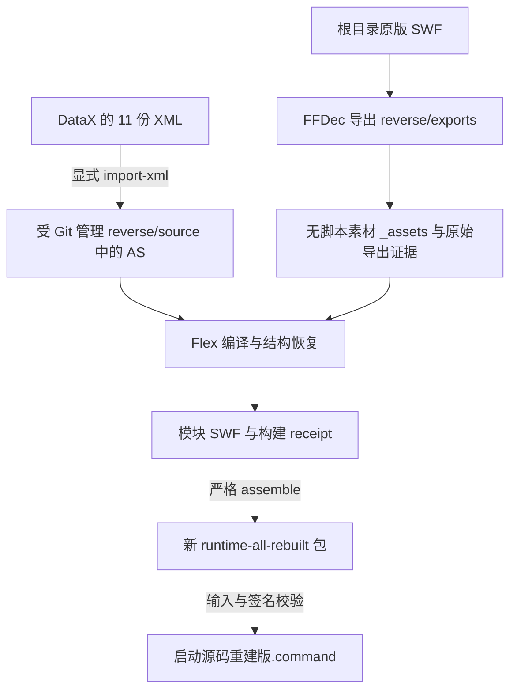

# 文件与目录：哪些能改，哪些是生成结果

[返回项目 README](../../README.md) · [源码入口](developer-source.md) · [工具手册](developer-tools.md) · [逐文件索引](catalog/README.md)

本文件路径均相对工作树根目录。`Main` 表示 `3_L4399Main_gamefile` 模块，`DataX` 表示 `DataX_v76`。SWF 是 Flash 程序／资源容器，ABC 是其中运行于 AVM2 的字节码，AS 是可编辑的 ActionScript 源文件。receipt 是一次实际构建记录，input fingerprint 是该次构建前后的输入文件与环境摘要。

## 从源码到游戏的文件流



AS 源码可重编译；现有视觉资源仍复用原包导出的图片、音效、字体、图形和时间轴。恢复源码不等于重新绘制所有素材。`reverse/source` 是正常编辑入口，`reverse/exports` 是原始导出及素材输入，`reverse/build` 是生成结果，三者不能混用。

## 根目录逐项

| 文件或文件族 | 内容与作用 | 开发时如何处理 |
| --- | --- | --- |
| `README.md` | 当前开发导航、版本与验证范围。 | 随功能更新。历史过程另存，不把过时“正在构建”当现状。 |
| `3_L4399Main_gamefile.swf` | 原版主程序；根类、主循环、存档与业务类等。 | 不覆盖；用来对照、导出和验证来源。 |
| `DataX_v76.swf` | DataX 资源与数据类，11份配置的来源。 | 不覆盖；改对应 source／config 后重建。 |
| `Map*.swf` | 各地图时间轴、碰撞与场景子对象、地图绑定类和附带业务类。 | 文件名不等于房间名称。地图51–55的后段是连续场景，不可推断每段独立可加载。 |
| `Enemy*.swf` | 敌人动画、特效及附带业务类；`EnemySkill_v7` 是敌人技能资源包。 | 修改前区分敌人ID、包ID和导出类名。 |
| `PlayerMc_X0/1/2_v10.swf` | 三套角色动画与相关逻辑。 | 与 Player/Skin 以及武器、装备实例契约一起验证。 |
| `WuQi_X*.swf` | 武器外观与动画。 | 保留类名、帧标签与绑定。 |
| `ZhuangBei_X*.swf`、`ShiZhuang_X*.swf` | 装备和时装外观。 | 同上。 |
| `equip_*.swf` | 69个动态外观包；由 `NewLoad` 根据皮肤与装备表加载。 | 新装备须同时核对配置 `加载文件`、实际文件和 SymbolClass。 |
| `Music_v3.swf` | 音乐及资源包装类。 | 音频负载与声音元数据都要核对。 |
| `Card_v17.swf` | 图鉴相关模块。 | 追踪主程序对该包的加载与类获取。 |
| `ChongWu_v8.swf` | 宠物相关模块。 | 结合主程序 `ChongWu` 与宠物配置。 |
| `VIP_v2.swf` | VIP相关资源／类。 | 存在离线不可用的服务边界，不假定所有入口可用。 |
| `XLUP_v4.swf` | 星灵相关模块。 | 从星灵界面及资源加载点追踪。 |
| `YZJH.swf` | 计划相关模块。 | 从 `JiHua_Interface` 等调用点追踪。 |
| `SHA256SUMS` | 原包166文件基线。 | `shasum -a 256 -c SHA256SUMS` 校验；不是重建包清单。 |
| `FlashPlayerStandAlone.exe`、`白屏修复-放游戏目录管理员身份运行.cmd` | 随原包的Windows播放器／脚本。 | 本机不用它们运行。 |
| `启动源码重建版.command` | 本分支正式重建入口；设定 Python、日志目录，调用 `launch_rebuilt.py`。 | 优先使用；`--check` 仅校验。 |
| `启动游戏.command` | 继承的原版启动与原版存档备份脚本。 | **不会启动重建包**，不要用来验证源码修改。 |
| `勇士的信仰.app/` | 继承的旧图标入口。 | 内部 `launch` 调用旧脚本；本机使用“源码重建”专用快捷方式。 |
| `presets/毕业体验档.sol` | 单角色自定义预设。 | 与实时完整SOL不同，不能直接覆盖全部角色存档。 |
| `tools/sol.py` | SOL/AMF解析、序列化、图结构比较库。 | 开发存档工具时复用，需保留类型／引用。 |
| `tools/create_graduate_save.py` | 从已有角色生成体验槽位；默认候选，`--apply` 写入。 | 角色工具，不是重建配方。 |
| `tools/import_preset.py` | 备份后导入预设；实际写入指定SOL。 | 运行前退出播放器，明确文件和槽位。 |
| `tools/graduate-data.json` | 体验档工具的装备／技能／地图数据摘录。 | 修改不会改变游戏自身数据库。 |
| `.gitattributes`、`.gitignore` | Git策略。 | 尤其保留运行环境、导出、构建和私人存档的忽略规则。 |
| `.git` | 此工作树的Git管理目录指针文件。 | 不移动／覆盖；用 `git worktree` 管理。 |

164 个 SWF 的每个确切文件名、对应 source 目录及 AS 数量均列于[模块目录](catalog/modules.md)，并在[文件索引](catalog/files.tsv)占独立一行。

## reverse/ 下的目录

| 路径 | 保存什么 | Git／更新规则 |
| --- | --- | --- |
| `reverse/source/<164个模块>/` | 当前受维护的恢复AS。710个Main、292个DataX，其余为162资源模块。 | 已跟踪。这里才是构建读取的代码；不能用原始导出覆盖修复。 |
| `reverse/source/DataX_v76-config/` | 11个可编辑XML和已有README。 | 已跟踪。改XML后必须运行导入器；目录自身也属于DataX构建输入。 |
| `reverse/tools/` | 盘点、恢复、构建、审计、运行检查工具。 | 已跟踪。部分为历史修复实验，不能当成全都可重复安全执行的日常命令，见工具手册。 |
| `reverse/manifests/` | 原始文件、导出、模块、修复、工具链和交付的JSON证据。 | 已跟踪。证据不等于当前状态；每份报告绑定其包／源码摘要与时间。 |
| `reverse/docs/` | 设计、开发、证据解释、历史和索引。 | 已跟踪／本次新增待提交。不往source中增加README，以免使整树输入指纹过期。 |
| `reverse/experiments/` | 专项探针源、构建回执、结果JSON、P-code片段、PNG和patch。 | 大量文件已跟踪。用于证明和排错；不是另一个canonical源码入口。 |
| `reverse/exports/` | FFDec原始导出、inventory、脚本、`_assets`、图像／音效等。 | Git忽略，但**部分是必需构建输入**。重新导出可能覆盖手改资产、改变指纹。 |
| `reverse/build/` | staging、模块产物、状态报告、各轮独立运行包。 | Git忽略。可重建不等于可以随手删除：当前快捷方式依赖其中已验证包。 |
| `reverse/logs/` | 导出、编译、启动和探针原始日志。 | Git忽略。失败时从具体日志定位，不只看退出码。 |
| `reverse/private/` | 受保护存档的本地备份等私人数据。 | Git忽略；不纳入文档索引或公开仓库。 |

### 导出目录的文件各做什么

一个 `reverse/exports/<module>/` 通常包含：

- `inventory/abc-*.json`：原ABC的类、方法、字符串等结构，盘点与审计用。
- `scripts/`：FFDec原始AS导出，可能带已知恢复问题；日常改 `reverse/source`，不要改这里的AS来期待编译生效。
- `scripts/_assets/assets.swf`：导出的无脚本视觉／时间轴容器；AS的 `[Embed]` 指向其中的 symbol。编译时恢复这些绑定。
- `scripts/_assets/*.bin`：嵌入二进制数据；部分实际是UTF-8 XML，例如Main任务表。扩展名不能代表内容语义。
- `scripts/_assets/*` 的音频／图像等：AS Embed的其他素材输入。
- `binaryData/`、`symbolClass/`：单独导出的数据／类绑定证据；具体目录取决于FFDec输出。
- 图形、图片、字体、文本、声音导出：用于查看与结构／帧渲染对照；不代表构建会自动读取每份可视化导出。
- `scripts-receipt.json`、`assets-receipt.json`：导出命令、原SWF摘要、退出状态、脚本数、错误标记及日志位置。

正常构建不恢复原FLA；必须保留实例名、SymbolClass、根时间轴、帧标签、音效元数据和ApplicationDomain加载关系。

### 构建目录的重要产物

| 路径 | 作用 |
| --- | --- |
| `reverse/build/main-probe/source/` | Main固定staging，拷贝canonical后进行编译兼容／存档名修复。重建会归档旧内容并重建此目录，不手改。 |
| `reverse/build/main-probe/run-*/` | 一轮Main的原始SWF、normalized SWF、编译日志、receipt以及可能归档的旧staging。 |
| `reverse/build/main-probe/build-all.json` | 最近完整Main编译回执；历史回执另在run目录，需核对实际产物和当前输入。 |
| `reverse/build/datax-recovery/` | DataX恢复／编译中间产物及XML导入前备份。 |
| `reverse/build/module-probe/<module>/` | 资源模块staging、编译器产物和恢复后的SWF。 |
| `reverse/build/project/status.json`、`audit.json` | 当前模块状态与严格校验报告，看 `all_rebuilt_ready` 和逐模块issues。 |
| `reverse/build/project/build-*/` | 本次流水线的 `stage-*.log`、`stages.json`。 |
| `reverse/build/project/input-hash-cache.json` | 内容摘要缓存，仅优化读取；不是可信构建证明本身。 |
| `reverse/build/runtime-all-rebuilt-*/` | 严格完整164包；每次assemble新建目录。正式入口只接受这种完整包。 |
| 包内 `assembly.json` | 每个SWF的来源、摘要、receipt、generation及组装状态。`runtime_validated=false` 仍需结合独立实测记录。 |
| 包内 `.provenance/` | 回执的包内快照，避免外部后续构建覆盖后丢失历史来源。 |
| `reverse/build/runtime-partial-*/` | 显式混合诊断输出；部分资源可能是原版fallback，不能叫全包重建。 |
| 其他 `runtime-*`／`*-probe` | 历史对照、header实验、诊断等，名称相近不表示可互换。 |

### manifests 与 experiments 如何查

先用 `final-acceptance.json`、`final-candidate-provenance.json`、`final-delivery-audit.json` 确认交付包；用 `original-files.json`、`swf-inventory.json`、`recovered-sources.json` 查原始来源和初始导出。后者是归档时的源码摘要，后续合法修改不应伪造为“原始导出”。

`*-proof.json`／`*-validation*.json` 记录限定方法和fixture的校验，`*-applied.json` 记录当时的补丁应用，`nonmain-repair-verification/` 按模块／产物摘要保存结果，`toolchains/<hash>.json` 保存对应工具链内容清单。这些报告不能替代真实游戏运行。

`experiments/final-runtime/` 是最终候选截图、诊断捕获和指定测试档摘要；`actual-class-harness/`、`decrement-harness/`、`ordered-comparison/` 等是针对语义的探针；`module-probe/<module>/result.json` 同时被正式组装读取；`datax-recovery/build-*.json` 是DataX构建凭据。**不是所有experiments都能删除或只当历史文件**。逐个文件的类型和可提取结构见catalog。

## 本机环境与新克隆

`.runtime/shared-tools` 是Java／FFDec／Flex工具根引用；`.runtime/prior` 指向旧分析缓存；`.runtime/rea` 是REA隔离副本；`.runtime/launchers` 是三版本布局中的本地App。不要修改共享工具来绕过校验，也不要将它们当成本分支自带的可移植依赖。

在新克隆中，先按原路径布局配置所需工具和Debugger，校验根目录原文件，运行 `swf_inventory.py` 和 `export_swf.py --mode scripts --jobs 2` 准备库存和Embed素材；查看素材时可另跑 `--mode assets --jobs 1`。已经跟踪的canonical源码和DataX恢复无需重新覆盖。然后 build → audit → assemble → --check → 实际运行。完整当前版本的新目录164模块复现仍是待验收项；遇到缺失依赖应按错误补齐，不承诺新机器一条命令成功。

## 文档索引维护

`catalog/generate.py` 只读仓库文件与Git列表，在catalog中生成TSV、模块Markdown和覆盖统计。不会执行游戏、导入构建脚本、扫描ignored导出／存档或修改构建输入：

```sh
/opt/miniconda3/envs/Qubit/bin/python reverse/docs/catalog/generate.py
```

全部AS按“实际声明／方法／Embed＋路径归类”记录；没有逐方法人工读完的类明确保留推断边界。源码新增或重命名后重生成，提交时将源码与索引一并审阅。
